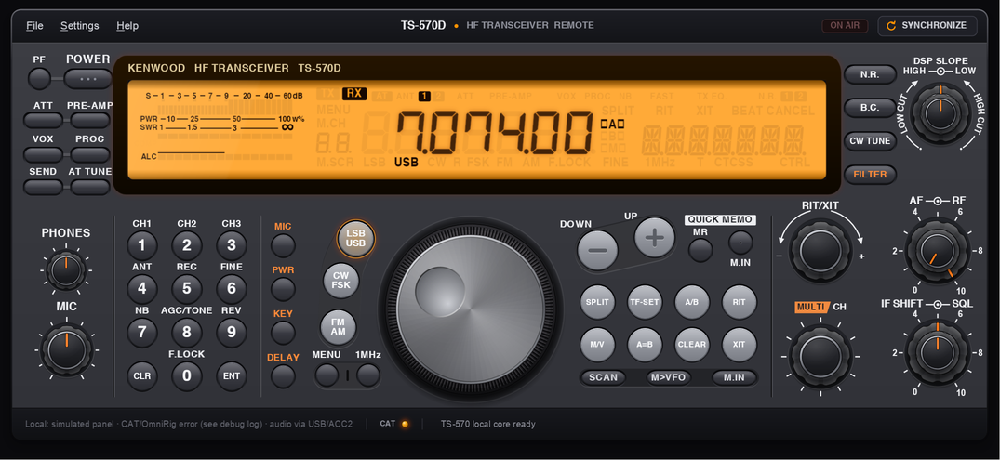

# ts570d_remote

Kenwood TS-570D remote control software for Windows using WPF and OmniRig CAT.

**Latest release:** `v0.4.0` (Git tag/release), Windows x64 build attached to the release.  
**Project file version:** `0.4.0` in `TS570_Remote.csproj`.

**Disclaimer:** This repository is **vibe coded** (AI-assisted, exploratory hacking) and is **only an experiment**. It is not production software, not audited for safety or correctness, and not a substitute for the manufacturer’s tools or documentation.

---

## Project status / how to help

**IF YOU KNOW C#, WPF, AND XAML: IT WOULD BE GREAT IF YOU COULD HELP OUT — OR FORK THIS AND RUN WITH IT YOURSELF.** The goal is not to leave this as eye candy: this tool should be **actually useful** and **usable for real** in the shack.

**Work in progress — honest expectations:** this repo is still **unfinished**, but it has moved forward significantly: CAT sync, meter handling, startup bootstrap, TX power editing flow, display color customization and a front panel redrawn to the real rig's proportions are now in place. It is still not production-grade software.

**Where things stand:** the front panel now follows the TS-570D closely; from here on the work is mostly **hands-on code**: CAT coverage and checking every control against the physical radio. Knowing **C#/WPF/XAML** helps a lot to keep the panel maintainable while that happens.

**CAT / OmniRig:** many key functions are now wired and usable, but CAT coverage is still incomplete and some paths still need verification against the physical TS-570D front panel behavior.

**Network / true remote:** **there is no server yet** to put the radio on the network and drive it from another PC or from outside the house. Today this is **local control** (Windows + OmniRig per your setup), not a LAN/Internet remote-control product.

If this sounds like your thing: open an issue, send a PR, or fork and go.

---

## What it is

A Windows desktop remote-control style UI for the **Kenwood TS-570D** HF transceiver, built with **WPF** and **OmniRig** for CAT. Treat it as a toy, not a guaranteed rig-control solution.



*Captured without a radio attached, so the status line reports a CAT/OmniRig error.*

### Inspiration

The idea comes from **Hans, DK9BP** — a fellow amateur who offered **TS-570 control software** from his website. He is now, sadly, **silent key**. His site is **no longer online**, so the original download is gone; what remains is mainly material on his **YouTube channel**.

If you want to see **how that program behaved in practice**, watch this recording on YouTube: https://www.youtube.com/watch?v=DLC3zaSg2NM

## Requirements

- **OS:** 64-bit Windows (WPF; `net10.0-windows`).
- **.NET 10 SDK** — the project targets .NET 10; install the matching SDK from [https://dotnet.microsoft.com/download](https://dotnet.microsoft.com/download) (see `TargetFramework` in `TS570_Remote/TS570_Remote.csproj`).
- **OmniRig** installed and configured for your rig at runtime (Rig1 expected by default).

## Build

From the **repository root** (where this `README.md` and `TS570_Remote.slnx` are):

**Restore and compile** (Debug):

```powershell
dotnet build TS570_Remote.slnx
```

The solution under `TS570_Remote/TS570_Remote.sln` is equivalent; the VS Code tasks in `.vscode/tasks.json` use that path.

**Run** the app (after a successful build):

```powershell
dotnet run --project TS570_Remote/TS570_Remote.csproj
```

**Release** output:

```powershell
dotnet build TS570_Remote.slnx -c Release
```

**Publish** (for example a folder of binaries you can copy elsewhere):

```powershell
dotnet publish TS570_Remote.slnx -c Release
```

Default build output is under `TS570_Remote/bin/<Configuration>/net10.0-windows/`. In VS Code you can also use the **build**, **publish**, and **watch** tasks from `.vscode/tasks.json` (F1 → *Tasks: Run Task*).

**Debugging:** `.vscode/launch.json` is set up to launch `TS570_Remote/bin/Debug/net10.0-windows/TS570_Remote.dll` with the *build* task as a pre-launch step.

## Current feature status

### Working (implemented and generally usable)

- [x] **CAT connection via OmniRig (Rig1)** with recurring sync loop.
- [x] **Startup bootstrap from rig state** before normal command push (reduces unsafe/default overwrites).
- [x] **VFO A/B frequency readback and tuning** (main VFO + MULTI/CH where applicable).
- [x] **Band up/down and mode switching** (wired CAT paths for active mode controls).
- [x] **TX/RX state and key status indicators** with LCD badge updates.
- [x] **TX power editor mode (`PWR`)** with 5 W step control and bounds normalization.
- [x] **Meter activity pipeline** (RX S-meter and TX PWR/SWR/COMP/ALC read paths, with visual bars and legends).
- [x] **ACC2 monitor audio path** (input/output device selection + monitor toggle).
- [x] **MIC level driving Windows TX playback endpoint volume** (separate from monitor level).
- [x] **Display color tool** (combined picker + hue + RGB + HEX + presets + persistent save).
- [x] **Theme-aware LCD badges/text** reacting to active display color.
- [x] **Faithful TS-570D faceplate**: matte charcoal panel with key shapes, legends, type sizes and positions measured on a front view of the rig (stadium side keys, grey dial keys with white legends, mode keys in their curved channel, slanted DOWN/UP pair, QUICK MEMO, SCAN rail, large tuning dial with finger dimple, knobs with the rig's nine-flute skirts, concentric AF/RF, IF SHIFT/SQL and DSP SLOPE knobs, 0–10 pot scales over ±150°, RIT arrows and LOW CUT / HIGH CUT legends set on their arcs). PHONES and MIC are level knobs (monitor volume and mic input) in place of the rig's jacks.
- [x] **Animated front panel**: vector-drawn knobs (eased turns, hover glow, power-on sweep, floating value readout while adjusting), springy keys with amber lit state, red ON AIR lamp, and a status line that flashes on every change.
- [x] **Dark themed menus and dialogs** (dark title bar on Windows 10/11, restyled audio routing and display color windows).

### Partially working / needs validation

- [~] **Meter calibration** is improved but still needs rig-by-rig validation for exact correspondence.
- [~] **Some CAT commands** are wired but not fully tested in all operating scenarios and modes.
- [~] **Visual parity with the physical front panel**: layout, legends and knobs follow the rig, with deliberate differences (PHONES/MIC are level knobs, the LCD is the app's own rendering).

### Not implemented or known limitations

- [ ] **No LAN/Internet remote backend/server** yet (this is local Windows control only).
- [ ] **No CAT command to force-open the physical radio’s front-panel menus** (e.g., remote `PWR` does not open the rig UI menu screen).
- [ ] **Full TS-570 command coverage** is not complete yet; some front-panel functions remain unimplemented.
- [ ] **Robust production hardening** (full error recovery, exhaustive edge-case handling, long-run stability testing) is still pending.

## Roadmap (next high-impact tasks)

- [ ] Complete CAT command coverage and verify each path against the TS-570D manual.
- [ ] Continue meter calibration and smoothing with real-world RF checks.
- [ ] Finish remaining front-panel controls and LCD state parity.
- [ ] Improve resilience (disconnect/reconnect handling, clearer diagnostics, safer fallbacks).
- [ ] Add true network remote architecture (server + client model).

## License

This project is released under the [MIT License](LICENSE).

**Safety:** Use at your own risk around real radios and RF equipment. The MIT License does not cover liability for how you operate hardware.

## Search and discoverability

To help Google index this project, a lightweight GitHub Pages SEO setup is included under `docs/`:

- `docs/index.html` / `docs/index.md`
- `docs/robots.txt`
- `docs/sitemap.xml`

Expected Pages URL:

- https://janitorhead.github.io/ts570d_remote/
